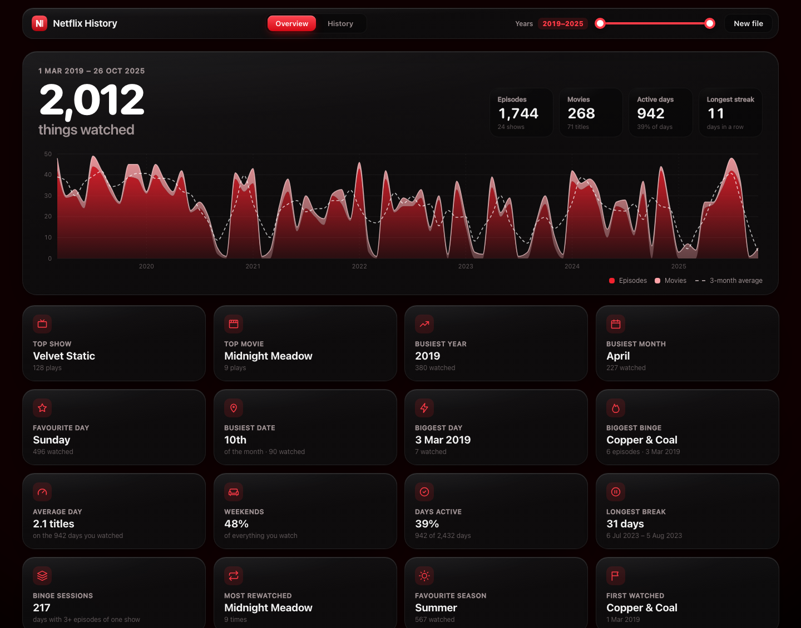
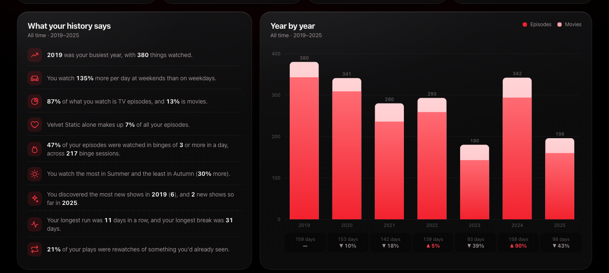
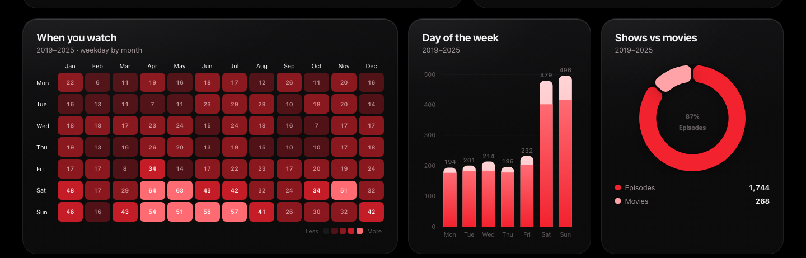
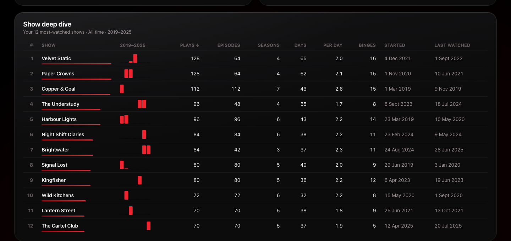
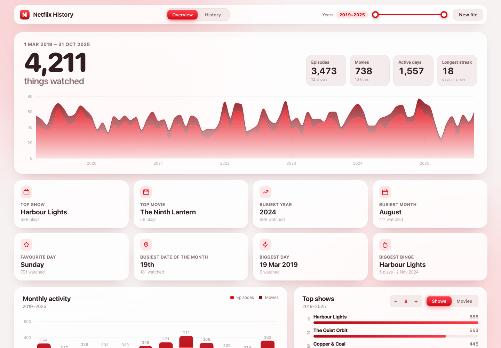
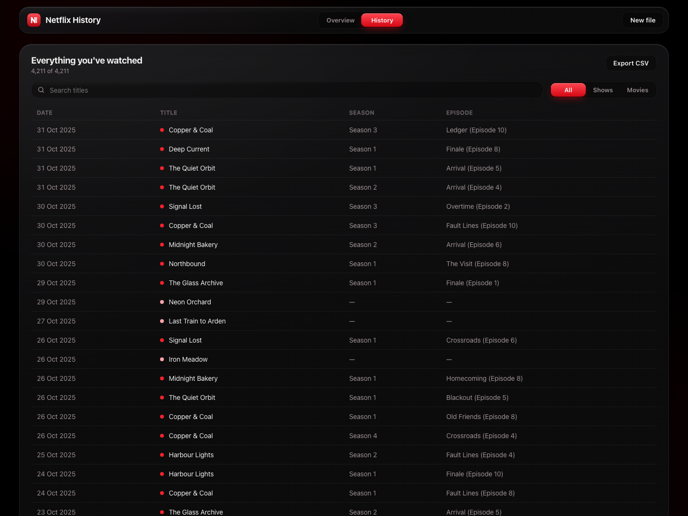
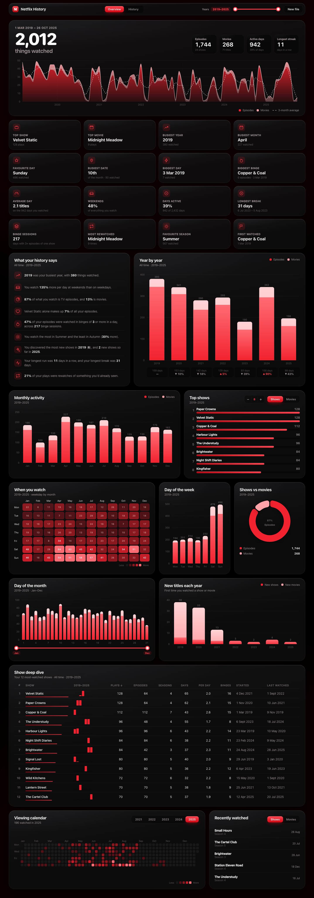
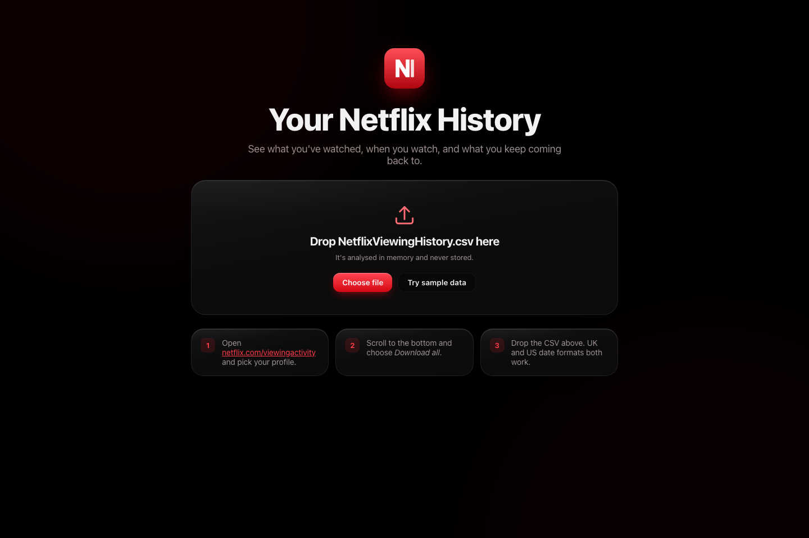

<a id="readme-top"></a>

<div align="center">
  

  <h3>Netflix History</h3>

  <p>
    See everything you've watched on Netflix as an interactive dashboard.<br>
    <b>Fully offline. Nothing is uploaded, nothing is saved.</b>
  </p>

  <p>
    <a href="https://github.com/ajd1776/Netflix-History-Dashboard/releases/latest/download/Netflix-History-mac.zip"><b>Download for Mac</b></a>
    ·
    <a href="https://github.com/ajd1776/Netflix-History-Dashboard/releases/latest/download/Netflix-History-windows.zip"><b>Download for Windows</b></a>
    ·
    <a href="#run-from-source">Run from source</a>
    ·
    <a href="https://github.com/ajd1776/Netflix-History-Dashboard/issues">Report a bug</a>
  </p>

  <p>
    <a href="https://github.com/ajd1776/Netflix-History-Dashboard/releases/latest"></a>
    <a href="https://github.com/ajd1776/Netflix-History-Dashboard/stargazers"></a>
    <a href="./LICENSE.txt"></a>
  </p>
</div>



<details>
  <summary><b>Contents</b></summary>

- [Private by design](#private-by-design)
- [Features](#features)
- [Screenshots](#screenshots)
- [Download](#download)
- [Get your Netflix history](#get-your-netflix-history)
- [Run from source](#run-from-source)
- [How it works](#how-it-works)
- [Contributing](#contributing)
- [License](#license)

</details>

## Private by design

Netflix History runs **entirely on your own computer**.

- **Fully offline.** The app starts a small server that only your own machine can reach (`127.0.0.1`). Nothing goes over the internet; it works with Wi-Fi switched off.
- **No data saved.** Your CSV is analysed in memory and forgotten when you close the app. It's never written to disk, uploaded, logged or tracked.
- **No account, no website.** There's nothing to sign up to, and no server anywhere holds your history.

## Features

**Overview**
- Total titles watched, episodes vs movies, active days and your **longest streak** of days in a row.
- A **timeline** of every month of your history, with a 3-month trend line. The years outside your filter dim, so you can see what you're looking at.
- **16 highlight tiles:** top show and movie, busiest year, month, weekday and date, biggest day, biggest binge, your average day, weekend share, how often you watch, longest break, binge sessions, most rewatched, favourite season and the first thing you ever watched.

**Analysis**
- **What your history says:** plain-English insights worked out from your data, like how much more you watch at weekends, how much of your viewing is binges, and how loyal you are to your favourite show.
- **Year by year:** totals with the percentage change on the year before and the days you watched.
- **When you watch:** a weekday-by-month heatmap with the count in every cell.
- **New titles each year:** how many shows and movies you tried for the first time.
- **Show deep dive:** your 12 most-watched shows compared on plays, episodes, seasons, days watched, episodes per day, binges, when you started and when you last watched, with a mini chart of each show by year. Click any heading to sort.

**Charts**
- **Monthly activity**, **day of the month** and **day of the week**, split into episodes and movies.
- **Top 3 to 20 shows or movies** for any range of years.
- **Shows vs movies** split.
- A **viewing calendar** heatmap for each year.
- **Recently watched** shows and movies.
- One **year filter** that updates the charts instantly, plus a month range for the day-of-month chart.

**History**
- Every title you've watched, with season and episode, **searchable** and filterable by shows or movies.
- **Export** an expanded CSV with show name, season and episode split into separate columns.

**Smart import**
- Works with both Netflix exports: `NetflixViewingHistory.csv` and the full-data `ViewingActivity.csv` (trailers and previews are skipped).
- Works out **UK (`31/12/2023`) and US (`12/31/23`) date formats** automatically.
- Tells shows from movies, including movies with a colon in the title (like *Mission: Impossible*).

**Design**
- Liquid Glass styling in Netflix reds, with **light and dark mode**.
- Respects the system **Reduce Transparency** and **Reduce Motion** settings.
- Hover any chart for exact numbers.
- No file to hand? Press **Try sample data** to explore a made-up history.

## Screenshots

**Insights and year-by-year growth**



**When you watch**



**Show deep dive**



| Light mode | History |
| --- | --- |
|  |  |

<details>
  <summary><b>See the whole dashboard</b></summary>



</details>



## Download

| | |
| --- | --- |
| **Mac** (Apple Silicon, M1 and later) | [Netflix-History-mac.zip](https://github.com/ajd1776/Netflix-History-Dashboard/releases/latest/download/Netflix-History-mac.zip) |
| **Windows** (10 and 11, 64-bit) | [Netflix-History-windows.zip](https://github.com/ajd1776/Netflix-History-Dashboard/releases/latest/download/Netflix-History-windows.zip) |

**Mac:** unzip and drag **Netflix History** into Applications. The app isn't notarised by Apple, so macOS blocks it the first time:

1. Open the app, then click **Done** on the warning.
2. Go to **System Settings → Privacy & Security** and scroll down to **Security**.
3. Click **Open Anyway** next to Netflix History, then confirm.

You only need to do this once. After that it opens normally.

**Windows:** unzip the folder anywhere and run **Netflix History.exe**. If SmartScreen warns you, choose **More info → Run anyway**. It uses the Microsoft Edge WebView2 runtime that comes with Windows 10 and 11.

Nothing else needs installing: each app includes everything it needs.

## Get your Netflix history

1. Go to [netflix.com/viewingactivity](https://www.netflix.com/viewingactivity) and pick your profile.
2. Scroll to the bottom and click **Download all**.
3. Open Netflix History and drop in the `NetflixViewingHistory.csv` you downloaded.

For more detail, request your full data at [netflix.com/account/getmyinfo](https://www.netflix.com/account/getmyinfo) and use `CONTENT_INTERACTION/ViewingActivity.csv` from the archive Netflix sends you.

## Run from source

Needs [uv](https://docs.astral.sh/uv/) and [Node](https://nodejs.org) 20 or later. Works on macOS, Windows and Linux.

```bash
git clone https://github.com/ajd1776/Netflix-History-Dashboard.git
cd Netflix-History-Dashboard
npm --prefix web install
npm start            # builds the app, starts the local server and opens your browser
```

Other commands:

```bash
npm run app          # open it in a desktop window instead of the browser
npm run build:mac    # package dist/Netflix History.app and a zip (macOS)
npm test             # Python tests + type-checked web build
npm run dev:api      # development: API with auto-reload on :8000
npm run dev:web      # development: web app with hot reload on http://localhost:5173
```

## How it works

| Part | Built with | Job |
| --- | --- | --- |
| `api/` | Python, [pandas](https://pandas.pydata.org), [FastAPI](https://fastapi.tiangolo.com), [uv](https://docs.astral.sh/uv/) | Reads the CSV, detects the date format, separates shows from movies and works out every total, streak and highlight. |
| `web/` | [React](https://react.dev), [TypeScript](https://www.typescriptlang.org), [Vite](https://vite.dev) | Draws the dashboard. Charts are hand-built SVG using [d3-scale](https://d3js.org/d3-scale) and [d3-shape](https://d3js.org/d3-shape) for full control of the design. |
| `desktop/` | [pywebview](https://pywebview.flowrl.com), [PyInstaller](https://pyinstaller.org) | Packages both into a native Mac or Windows app. |

Python does all the analysis and sends the results to the page once. When you move a filter, the page only re-adds numbers it already has, so every chart updates instantly. New releases are built for Mac and Windows automatically by [GitHub Actions](.github/workflows/release.yml).

<p align="right">(<a href="#readme-top">back to top</a>)</p>

## Contributing

Suggestions and pull requests are welcome. Open an [issue](https://github.com/ajd1776/Netflix-History-Dashboard/issues) with the tag "enhancement", or:

1. Fork the project
2. Create a branch (`git checkout -b feature/AmazingFeature`)
3. Commit your changes (`git commit -m 'Add some AmazingFeature'`)
4. Push the branch (`git push origin feature/AmazingFeature`)
5. Open a pull request

## License

Distributed under the MIT License. See [`LICENSE.txt`](./LICENSE.txt).

<p align="right">(<a href="#readme-top">back to top</a>)</p>
